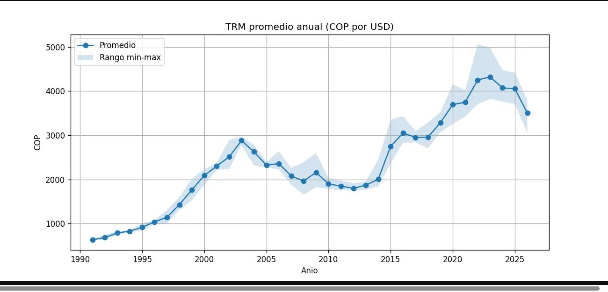

# Procesamiento en batch con Apache Spark: TRM Colombia

Proyecto de la Tarea 3 del curso Big Data (UNAD). Analiza el historico de la **Tasa Representativa del Mercado (TRM)**, es decir, el valor del dolar en pesos colombianos, usando **Apache Spark (PySpark)** sobre **Hadoop HDFS**.

## Problema
Entender como ha evolucionado el valor del dolar frente al peso colombiano desde 1991: tendencia, variacion anual y los picos historicos.

## Dataset
- **Nombre:** Tasa de Cambio Representativa del Mercado - Historico
- **Fuente:** datos.gov.co (Superintendencia Financiera de Colombia)
- **Descarga directa:** https://www.datos.gov.co/api/views/mcec-87by/rows.csv
- **Columnas:** `VALOR`, `UNIDAD`, `VIGENCIADESDE`, `VIGENCIAHASTA`
- **Registros:** aproximadamente 7.800

## Que hace el codigo (`batch_trm.py`)
1. **Carga** el CSV desde HDFS a un DataFrame de Spark.
2. **Limpieza:** elimina nulos y duplicados, convierte `VIGENCIADESDE` a fecha y crea la columna `ANIO`.
3. **EDA:** estadisticas descriptivas, promedio/minimo/maximo por anio, top 10 de valores mas altos y dias con TRM mayor a 5000.
4. **Visualizacion:** grafica de la TRM promedio anual con el rango minimo-maximo (`trm_grafica.png`).

## Entorno
- Ubuntu Server 22.04 en VirtualBox
- Java 11, Hadoop 3.3.6, Apache Spark 3.5.8
- Python 3 con `pyspark`, `matplotlib` y `pandas`

## Como ejecutarlo

**1. Instalar dependencias de Python**
```bash
pip install pyspark==3.5.8 matplotlib pandas
```

**2. Iniciar Hadoop** (con el usuario `hadoop`)
```bash
start-all.sh
```

**3. Cargar el dataset a HDFS**
```bash
wget https://www.datos.gov.co/api/views/mcec-87by/rows.csv
hdfs dfs -mkdir -p /Tarea3
hdfs dfs -put rows.csv /Tarea3
hdfs dfs -ls /Tarea3
```

**4. Iniciar Spark** (con el usuario `vboxuser`)
```bash
start-master.sh
start-worker.sh spark://BIGDATA:7077
```

**5. Ejecutar el analisis**
```bash
python3 batch_trm.py
```
Al terminar se genera `trm_grafica.png` en la carpeta actual.

> Si usas otro nombre de maquina o ruta de HDFS, ajusta `hdfs://localhost:9000/Tarea3/rows.csv` en `batch_trm.py`.

## Resultados
- La TRM paso de cerca de 600 COP en 1991 a mas de 4.000 COP en 2022-2023.
- El maximo historico del dataset es **5.061,21 COP** (5 de noviembre de 2022).
- Solo 5 dias superan los 5.000 COP, todos en noviembre de 2022.


